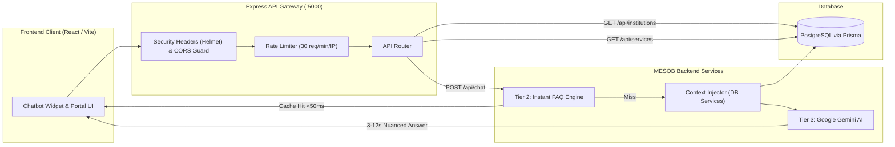

<div align="center">

# 🏛️ Hawassa MESOB Portal

### Unified Citizen Services & AI-Powered Multilingual Assistant

[](https://nodejs.org/)
[](https://expressjs.com/)
[](https://www.postgresql.org/)
[](https://www.prisma.io/)
[](https://deepmind.google/technologies/gemini/)
[](#-multilingual-support)
[](#-running-automated-tests)

<p align="center">
  <b>A single digital gateway for citizens of Hawassa City to discover government institutions, browse public services, check documentation requirements, and get instant answers via a context-aware AI chatbot.</b>
</p>

---

[Endpoints Matrix](#-api-endpoints-matrix) • [Chatbot Integration](#-chatbot-api-integration) • [Institutions & Services](#-institutions--services-api) • [Frontend Starter Code](#-frontend-integration-examples) • [Local Setup](#-local-development--testing)

</div>

---

## 🧭 System Architecture



---

## 📡 API Endpoints Matrix

All endpoints are hosted on the local development network:
```http
http://10.20.254.64:5000
```

| Method | Endpoint | Description | Auth | Query / Body Params |
| :---: | :--- | :--- | :---: | :--- |
| `GET` | `/api/health` | Service health status & server timestamp | Public | — |
| `POST` | `/api/chat` | Multilingual citizen inquiry chatbot | Public | `{ message, locale, sessionId }` |
| `GET` | `/api/institutions` | Directory of public institutions | Public | `?locale=en\|am\|sid&page=1&limit=20&search=` |
| `GET` | `/api/institutions/:id` | Institution details + full services list | Public | `?locale=en\|am\|sid` |
| `GET` | `/api/institutions/:id/services` | Paginated services for an institution | Public | `?locale=en\|am\|sid&page=1&limit=20` |
| `GET` | `/api/services` | Global public services catalog across all bureaus | Public | `?locale=en\|am\|sid&page=1&limit=20&search=` |
| `GET` | `/api/services/:id` | Single service card with parent institution | Public | `?locale=en\|am\|sid` |

---

## 🤖 Chatbot API Integration

```http
POST /api/chat
Content-Type: application/json
```

### 1. Request Body Schema

```json
{
  "message": "What documents do I need to get a new Trade License?",
  "locale": "en",
  "sessionId": "b47c87c2-9e32-4d2b-9831-7b0b8d2ef020"
}
```

#### Field Specifications

| Field | Type | Required | Default | Rules & Constraints |
| :--- | :---: | :---: | :---: | :--- |
| `message` | `string` | **Yes** | — | Non-empty string. Max **500 characters**. Strips unprintable control characters. |
| `locale` | `string` | No | `"en"` | Must be one of: `"en"` (English), `"am"` (Amharic), `"sid"` (Sidaamu Afoo). |
| `sessionId` | `string` | No | — | Optional tracking UUID (RFC 4122 v1–v5). |

> ⚠️ **Strict Locale Validation**: Passing an unsupported locale (e.g. `"fr"`) returns `400 Bad Request`.

---

### 2. Response Body Schema

```json
{
  "reply": "**Requirements for Commercial Registration & Trade License:**\n\n1. Valid National ID or Passport\n2. Office lease agreement verified by Kebele\n3. TIN Certificate from Revenue Authority\n\n📍 Visit **Counter 4** at Hawassa MESOB Center.",
  "tier": 2
}
```

### 3. Response Tiers Explained

The `tier` property indicates how the response was generated. Use this to adapt your client UI:

| `tier` Value | Type | Engine / Source | Latency | Recommended UI Behavior |
| :---: | :---: | :--- | :---: | :--- |
| `2` | `number` | Instant FAQ Database & Keyword Lookup | < 50ms | Render immediately. No typing loader needed. |
| `3` | `number` | Google Gemini AI (Context-Grounded) | 3–12s | Show typing indicator / loading dots while awaiting response. |
| `"scope-guard"` | `string` | Pre-LLM Guardrail | < 10ms | User asked off-topic query. Render polite refusal. |
| `"scope-refusal"` | `string` | Post-Lookup Scope Boundary | < 50ms | Query is outside MESOB service domain. |
| `"context-fallback"` | `string` | Database Context Fallback | < 100ms | AI unavailable; returning verified raw service instructions. |
| `"fallback"` | `string` | Hardcoded Safe Response | Instant | Render fallback message; optionally show offline banner. |
| `"rate-limit"` | `string` | Express Rate Limiter | Instant | HTTP 429: Show "Rate limit reached. Please wait a moment." |

---

## 🏛️ Institutions & Services API

### 1. List Institutions

```http
GET /api/institutions?locale=am&page=1&limit=10
```

**Response (`200 OK`)**:
```json
{
  "data": [
    {
      "id": "5935b034-cc1d-4504-ab08-b8e301827311",
      "code": "HAWASSA_TRADE",
      "name": "የሀዋሳ ከተማ አስተዳደር ንግድ ቢሮ",
      "icon": "/city.jpg",
      "floorRoomNumber": "Main Hall, Counter 4",
      "contactPhone": "+251 46 220 1137",
      "serviceCount": 5
    }
  ],
  "meta": {
    "total": 6,
    "page": 1,
    "limit": 10,
    "totalPages": 1
  }
}
```

### 2. Single Institution with Embedded Services

```http
GET /api/institutions/5935b034-cc1d-4504-ab08-b8e301827311?locale=en
```

**Response (`200 OK`)**:
```json
{
  "id": "5935b034-cc1d-4504-ab08-b8e301827311",
  "code": "HAWASSA_TRADE",
  "name": "Hawassa City Administration Trade Bureau",
  "icon": "/city.jpg",
  "floorRoomNumber": "Main Hall, Counter 4",
  "contactPhone": "+251 46 220 1137",
  "services": [
    {
      "id": "c1f7ad42-124b-4b47-...",
      "title": "Trade Name Amendment for Business Organizations",
      "description": "Approval of legal business name modifications.",
      "requirements": [
        "National ID",
        "Renewed passport, driver license or digital ID",
        "Draft meeting minutes authorizing name change"
      ],
      "estimatedFee": 150.0,
      "processingDays": 2
    }
  ]
}
```

### 3. Global Public Services Catalog

```http
GET /api/services?locale=en&page=1&limit=20&search=Commercial
```

Returns flat paginated services with embedded institution profile on each item.

---

## 🌐 Multilingual Support

The portal natively supports Ethiopia's prominent administrative languages:

| Code | Language | Native Name | Default |
| :---: | :--- | :--- | :---: |
| `en` | English | English | ✅ Yes |
| `am` | Amharic | አማርኛ | — |
| `sid` | Sidaamu Afoo | Sidaamu Afoo | — |

```json
// Example in Sidaamu Afoo:
GET /api/institutions?locale=sid
{
  "name": "Hawaasa Quchumi Gashshooti Dureeyye Biiro",
  ...
}
```

---

## 🛡️ Security, Rate Limits & Error Handling

### Rate Limiting

- **Chatbot (`POST /api/chat`)**: **30 requests / minute** per IP.
- **General Endpoints (`/api/*`)**: **120 requests / minute** per IP.

Each response contains rate-limit metadata headers:
- `RateLimit-Limit`: Maximum quota for the window.
- `RateLimit-Remaining`: Remaining calls available.
- `RateLimit-Reset`: Seconds remaining until quota reset.

### Error Response Schema

When an error occurs (`400`, `403`, `429`, or `500`), the API returns:

```json
{
  "reply": "Friendly message suitable for UI display",
  "error": "Descriptive technical error message"
}
```

| HTTP Status | Trigger Condition | Code |
| :---: | :--- | :--- |
| `400` | Message is missing, empty, or exceeds 500 characters | `Message exceeds 500 characters.` |
| `400` | Invalid locale parameter | `Unsupported locale specified.` |
| `400` | Malformed JSON payload | `Invalid JSON payload` |
| `403` | Unauthorized browser domain violating CORS | `Origin not allowed by CORS policy` |
| `404` | Institution or Service ID not found | `Institution not found.` |
| `429` | IP exceeded 30 chat requests / minute | `Too many requests. Rate limit exceeded.` |
| `500` | Internal server or unhandled runtime error | `Internal server error` |

---

## 💻 Frontend Integration Examples

### React Hook (`useChatbot.js`)

```jsx
import { useState, useCallback } from "react";

const CHAT_ENDPOINT = "http://10.20.254.64:5000/api/chat";

export function useChatbot(locale = "en") {
  const [messages, setMessages] = useState([]);
  const [isThinking, setIsThinking] = useState(false);
  const [error, setError] = useState(null);

  const sendMessage = useCallback(async (userText) => {
    const text = userText?.trim();
    if (!text || text.length > 500) return;

    // Append user message immediately
    setMessages((prev) => [...prev, { role: "user", content: text }]);
    setIsThinking(true);
    setError(null);

    try {
      const res = await fetch(CHAT_ENDPOINT, {
        method: "POST",
        headers: { "Content-Type": "application/json" },
        body: JSON.stringify({ message: text, locale }),
      });

      if (res.status === 429) {
        throw new Error("Rate limit exceeded. Please wait a minute.");
      }

      const data = await res.json();
      if (!res.ok) throw new Error(data.reply || data.error);

      setMessages((prev) => [
        ...prev,
        { role: "assistant", content: data.reply, tier: data.tier }
      ]);
    } catch (err) {
      setError(err.message || "Failed to communicate with MESOB.");
    } finally {
      setIsThinking(false);
    }
  }, [locale]);

  return { messages, isThinking, error, sendMessage };
}
```

### Complete UI Component with Markdown (`ChatWidget.jsx`)

```jsx
import React, { useState } from "react";
import ReactMarkdown from "react-markdown";
import { useChatbot } from "./useChatbot";

export function ChatWidget({ locale = "en" }) {
  const [input, setInput] = useState("");
  const { messages, isThinking, error, sendMessage } = useChatbot(locale);

  const onSubmit = (e) => {
    e.preventDefault();
    if (!input.trim() || isThinking) return;
    sendMessage(input);
    setInput("");
  };

  return (
    <div className="flex flex-col h-[500px] w-96 rounded-2xl shadow-2xl bg-white border border-slate-200 overflow-hidden font-sans">
      {/* Header */}
      <div className="bg-gradient-to-r from-emerald-600 to-teal-700 p-4 text-white">
        <h3 className="font-bold text-lg">MESOB Assistant</h3>
        <p className="text-xs text-emerald-100">Hawassa Public Services & AI Guide</p>
      </div>

      {/* Message List */}
      <div className="flex-1 p-4 overflow-y-auto space-y-3 bg-slate-50">
        {messages.map((m, idx) => (
          <div key={idx} className={`flex ${m.role === "user" ? "justify-end" : "justify-start"}`}>
            <div className={`p-3 max-w-[85%] rounded-2xl text-sm ${
              m.role === "user"
                ? "bg-emerald-600 text-white rounded-br-none"
                : "bg-white text-slate-800 shadow-sm border border-slate-200 rounded-bl-none prose prose-sm"
            }`}>
              {/* Note: Assistant replies may contain markdown bullet lists & bold text */}
              <ReactMarkdown>{m.content}</ReactMarkdown>
            </div>
          </div>
        ))}
        {isThinking && (
          <div className="flex items-center space-x-1.5 text-slate-400 text-xs italic p-2">
            <span className="animate-bounce">●</span>
            <span className="animate-bounce delay-100">●</span>
            <span className="animate-bounce delay-200">●</span>
            <span>MESOB AI is checking service guides...</span>
          </div>
        )}
        {error && (
          <div className="p-2 text-xs bg-red-50 text-red-600 rounded border border-red-200 text-center">
            {error}
          </div>
        )}
      </div>

      {/* Input Field */}
      <form onSubmit={onSubmit} className="p-3 border-t bg-white flex gap-2">
        <input
          value={input}
          onChange={(e) => setInput(e.target.value)}
          placeholder="Ask a question..."
          maxLength={500}
          className="flex-1 px-3 py-2 text-sm border rounded-xl outline-none focus:ring-2 focus:ring-emerald-500"
        />
        <button
          type="submit"
          disabled={!input.trim() || isThinking}
          className="px-4 py-2 bg-emerald-600 text-white text-sm font-semibold rounded-xl hover:bg-emerald-700 disabled:opacity-50 transition"
        >
          Send
        </button>
      </form>
    </div>
  );
}
```

---

## 🧪 Local Development & Testing

### Prerequisites
- **Node.js**: v20 or higher
- **PostgreSQL**: Running instance with `DATABASE_URL` configured in `server/.env`

### Quick Start

```bash
# 1. Clone repository
git clone https://github.com/GurmesaAyele/hawassa-mesob.git
cd hawassa-mesob

# 2. Setup Server
cd server
npm install
npx prisma generate
npm run dev

# Server will start on http://localhost:5000
```

### 🔬 Running Automated Tests

The repository includes a comprehensive, 100% automated test suite validating security, rate limiting, CORS, input sanitization, and REST API contracts:

```bash
cd server
npm test
```

```text
▶ Security Headers & Server Identification
  ✔ GET /api/health should include Helmet security headers and omit X-Powered-By
▶ Input Validation & Body Sanitization (POST /api/chat)
  ✔ Valid English, Amharic, Sidaamu Afoo queries return 200
  ✔ Empty / Whitespace-only / 500+ char messages return 400
  ✔ Unsupported locales & malformed JSON return 400
▶ Scope Guard & Prompt Injection Defense
  ✔ Off-topic inquiries trigger scope-guard refusal
  ✔ System prompt leaks / injection attempts are securely deflected
▶ CORS Origin Hardening
  ✔ Trusted origins accepted; untrusted origins rejected with 403
▶ Rate Limiting Enforcement
  ✔ POST /api/chat enforces per-IP limits and returns RateLimit headers
▶ Institutions & Services API Endpoints
  ✔ GET /api/institutions returns multilingual service counts & pagination
  ✔ GET /api/institutions/:id returns details + nested active services
  ✔ GET /api/services returns catalog with parent institution metadata

ℹ tests 25 | suites 6 | pass 25 | fail 0
```

---

<div align="center">
  <sub>Developed for Hawassa MESOB Center • Hawassa City Administration, Sidama Region, Ethiopia</sub>
</div>
